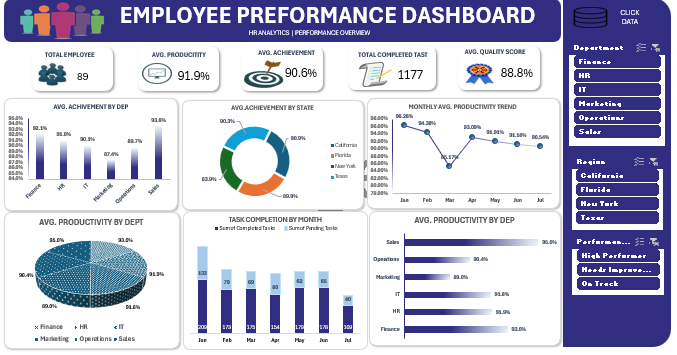

# Employee Performance Analytics Dashboard

## Project Overview
An Excel-based dashboard designed to analyze employee performance, productivity, achievement, and task completion across departments and states.

## Key Performance Indicators (KPIs)
- Total Employees: 89
- Average Productivity: 91.9%
- Average Achievement: 90.6%
- Completed Tasks: 1,177
- Average Quality Score: 88.8%

## Dashboard Features
- Employee Performance Overview
- Department-wise Performance Analysis
- State-wise Achievement Analysis
- Monthly Productivity Trends
- Task Completion Analysis
- Interactive Department and Region Filters

## Tools & Technologies
- Microsoft Excel
- Data Cleaning & Analysis
- Pivot Tables & Pivot Charts
- KPI Reporting
- Data Visualization

## Dashboard Preview

## Project Files
- **Excel Workbook:** Contains both Data and Dashboard sheets.
- **Screenshot:** Dashboard preview.

## Key Learnings
- Data Analysis using Excel
- KPI Monitoring
- Interactive Dashboard Creation
- Data Visualization

## Author
Kalpesh Gosavi

*My First Data Analytics Project*
